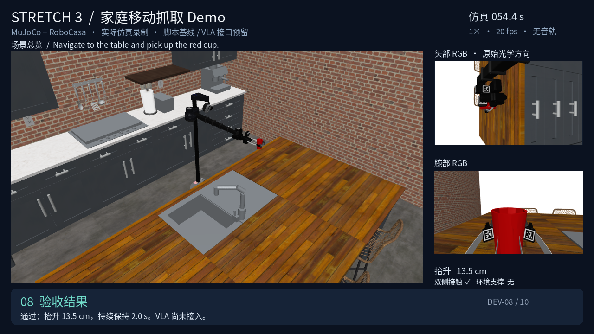
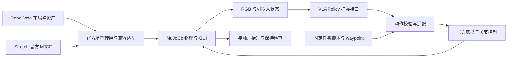

# Stretch VLA Home

基于 **Hello Robot Stretch 3、MuJoCo 和 RoboCasa** 的家庭移动操作仿真工程。当前实现一个固定厨房中的“导航到岛台并拿起红杯”脚本基线，并提供后续 VLA 二次开发接口。

本项目复用官方机器人模型、动力学、底盘控制、关节/夹爪指令映射、相机渲染、厨房布局及接触检查。VLA checkpoint、模型推理、训练和语义导航属于后续开发范围。

## 按文件夹分工

团队按 **01～07 七个目录** 分别开发。真实实现已迁入对应目录；每组 README 包含脚本、任务拆分、上下游交接和验收要求。第二组统一命名为 `02_manipulation_vla`。

| 组 | 开发目录与说明 | 主要负责 | 可运行入口 |
|---|---|---|---|
| 01 | [01_navigation](01_navigation/README.md) | 导航、避障、目标接近 | `01_navigation/run_navigation.py` |
| 02 | [02_manipulation_vla](02_manipulation_vla/README.md) | 机械臂、抓取、VLA、任务编排 | `02_manipulation_vla/run_task.py` |
| 03 | [03_data_generate](03_data_generate/README.md) | 场景和示范数据生成 | `03_data_generate/collect_episode.py` |
| 04 | [04_s2r](04_s2r/README.md) | Sim-to-Real 接口、标定和部署适配 | `04_s2r/export_sim_contract.py` |
| 05 | [05_benchmark](05_benchmark/README.md) | 成功判据、批量评测、回归 | `05_benchmark/run_benchmark.py` |
| 06 | [06_data_process](06_data_process/README.md) | 感知、数据校验、清洗和格式转换 | `06_data_process/process_episode.py` |
| 07 | [07_extension](07_extension/README.md) | 公共机器人接口、安装、仿真与演示扩展 | `07_extension/run_sim.py`、`record_demo.py` |

**[完整任务分工与协作约定](docs/development/README.md)**。导航和抓取基线可运行，VLA 和真机后端留待对应组开发。

## 示意视频

[](media/stretch_vla_demo.mp4)

**[播放 / 下载 MP4](media/stretch_vla_demo.mp4)** · [录制说明](media/README.md) · [视频元数据](media/stretch_vla_demo.json)

视频长 **56.3 秒**，1280×720、20 fps、1 倍仿真速度、无音轨。连续展示初始化、导航、预抓取、接近、夹紧、抬升和验收，并附场景总览、两路机器人 RGB 和阶段。视频中的 DEV 编号为此前十项细分任务编号；新的七组归属见分工手册中的映射表。实测杯子抬升约 **13.5 cm**，保持检查通过 **2 秒**。这是使用仿真真值目标的脚本基线，尚未加载 VLA。

已有仿真环境后，可用下面命令重新录制到新目录：

```bash
UV_CACHE_DIR=.cache/uv .tools/uv pip install --python .venv/bin/python -r requirements-video.txt
MUJOCO_GL=egl .venv/bin/python 07_extension/record_demo.py \
  --output out/my_demo/demo.mp4 --run-dir out/my_demo/run
```

录制需要可用的 EGL 和 Noto Sans CJK 中文字体，详见 [媒体 README](media/README.md)。输出已存在时脚本拒绝覆盖。

## 快速运行

在项目目录执行。当前安装脚本面向 Linux x86_64，已在 Ubuntu 22.04 上部署。

```bash
bash 07_extension/install.sh
.venv/bin/python 02_manipulation_vla/run_task.py
```

已有环境和场景时只需第二条命令。GUI 中可以实时观察机器人执行；`--linger 30` 可在任务结束后继续显示 30 秒。

[Navigation Prototype](01_navigation/README.md) 提供实时 Web Console、传感器地图和 A/B 巡检。安装完成后运行 `.venv/bin/python 01_navigation/run_console.py --viewer`，在 `http://127.0.0.1:8765/` 操作同一幕仿真。

```bash
# 单独查看厨房，不执行抓取
.venv/bin/python 07_extension/run_sim.py --seconds 60

# 无窗口执行，仍渲染两路机器人 RGB
MUJOCO_GL=egl .venv/bin/python 02_manipulation_vla/run_task.py --headless

# 仅检查物理，不渲染相机
.venv/bin/python 02_manipulation_vla/run_task.py --headless --no-cameras

# 测试
.venv/bin/python -m pytest -q

# 官方原始示例
.venv/bin/launch_sim
```

依赖下载需要网络，图形渲染需要可用的 OpenGL/EGL。安装过程中使用项目内 `.tools/` 和 `.venv/`，不需要 ROS2/Nav2。首次下载约 2.93 GB 资产，解压约 7 GB，另需 Python 包和仓库空间。当前 Torch 使用 CPU 版，仅满足旧版 RoboCasa 的传递依赖。

## Stretch 3 圆桌水瓶抓放

Stretch 3 在 MuJoCo 圆桌场景中完成抓起、放下和撤手。它从固定停靠状态起步，用自身的逆运动学跟踪从 G1 示教回放提取的 TCP 位置，并执行对应的夹爪开合事件。安装完成后，在项目根目录运行：

```bash
.venv/bin/python 03_data_generate/build_round_table.py
.venv/bin/python 02_manipulation_vla/run_tcp_retarget.py --output out/round_table_demo
```

加 `--gui` 可在 MuJoCo 窗口观看。仓库提供单条 TCP 输入、初始状态和圆桌资产。复跑指标与逐步轨迹由脚本写到本地 `out/round_table_demo/`。[抓放与数据交接](02_manipulation_vla/examples/g1_tcp_round_table/README.md) · [Stretch 仿真录像](media/stretch_round_table.mp4)

## 运行结果

每次任务在 `out/task/` 写出阶段记录 `stages.json`、抓取指标 `metrics.json`、保持阶段接触轨迹 `success_trace.json`，以及每阶段的头部、腕部 RGB。成功返回退出码 0，未达标返回 1；不可达目标、导航超时等会显式报错。

成功要求两侧手指同时接触目标、目标比初始稳定位置抬高至少 5 cm、没有台面等环境支撑接触，并连续保持至少 1 秒。仅靠物体高度变化不会判成功。任务执行中没有焊接约束、目标瞬移或直接修改物体状态。

具体实测记录见 [验证记录](docs/validation.md)。

相关开源工作及可复用位置见 [调研说明](docs/related_work.md)。

## 项目如何工作



1. `03_data_generate/build_scene.py` 定义一个小型 RoboCasa 任务子类，调用 Stretch 的 `model_generation_wizard`，加载官方 `one_wall_large` 布局和 `industrial` 风格，再通过官方 MJCF 集成入口替换机器人。
2. 场景包含真实碰撞的厨房岛台和官方 Objaverse `cup_2` 模型。杯子缩放为原尺寸的 0.85，并在生成文件中改成红色。桌面在这里特指厨房岛台，不是另外添加的独立餐桌。
3. `RobotInterface` 在单进程中复用 `MujocoServer`，按仿真时钟调度物理、动作和相机。底盘速度经官方差速运动学转换为轮速，手臂和夹爪经官方指令映射执行。
4. `01_navigation/navigation/` 实现已知空闲通道中的 waypoint 闭环控制。`arm_controller.py` 使用 MuJoCo 官方正运动学和 SciPy 有界最小二乘求解五个独立手臂自由度，底盘在 IK 中固定。伸缩臂的四个滑动关节保持相等，总伸长量作为一个动作坐标。
5. `02_manipulation_vla/tasks/` 串联初始化、导航、预抓取、接近、夹紧、抬升和保持。`05_benchmark/evaluation/` 复用 robosuite 的 `check_contact` 检查碰撞组。

## 代码目录

```text
stretch_vla_home/
├── 01_navigation/          # navigation/，独立导航入口
├── 02_manipulation_vla/    # manipulation/、vla/、tasks/，完整抓取入口
├── 03_data_generate/       # 场景、资产下载、逐控制周期示范采集
├── 04_s2r/                 # s2r/ 后端协议，仿真参数导出
├── 05_benchmark/           # evaluation/、tests/，批量评测
├── 06_data_process/        # perception/，数据校验与转换
├── 07_extension/           # robot/，安装、仿真 GUI、视频录制
├── configs/               # 各组共用的机器人、场景与任务配置
├── scenes/                # 场景生成产物
├── third_party/           # 固定版本的官方仓库与资产
├── docs/                  # 分工、兼容性、验证与调研
├── media/                 # 示意视频
├── out/                   # 实验和数据输出（不提交）
└── project_bootstrap.py   # 将编号目录中的 Python 包加入搜索路径
```

编号目录是团队工作区，内部 `navigation`、`manipulation`、`vla` 等才是 Python 包。所有命令行脚本已自动初始化导入路径；Notebook 或自写脚本在项目根目录先调用下面的 `activate()`，不使用 `import 01_navigation`。详细迁移表见分工手册。

## 统一控制与观测接口

```python
from project_bootstrap import activate
activate()
from robot.robot_interface import RobotInterface

with RobotInterface("scenes/kitchen/generated/kitchen.xml", gui=True) as robot:
    obs = robot.get_observation("Navigate to the table and pick up the red cup.")
    rgb = robot.get_camera_image("head")
    state = robot.get_state()
    robot.move_base(v=0.1, w=0.0)
    robot.step()
    robot.move_base(0.0, 0.0)
    robot.set_gripper(open=True)
    robot.move_to_pose({"position": [3.55, -1.95, 0.98]}, duration=2.0)
```

位置单位为米，角度为弧度；笛卡尔姿态使用世界坐标系、Z 轴向上、四元数 `wxyz`。`move_to_pose` 有可达性检查，但不提供通用避障规划。`step()` 推进一步动作周期，内部执行多个物理步；默认物理 500 Hz、动作 20 Hz、相机 10 Hz。头部 RGB 为 `240×424×3`，腕部 RGB 为 `270×480×3`，均为 RGB uint8 HWC，保留原始相机旋转方向。观测同时提供状态时间和图像时间。

`get_state()` 中夹爪读数保留官方 `[-0.376, 0.56]` 标定范围，`to_policy_input()` 将它转换为归一化开度。`get_object_pose(name)` 提供用于脚本目标和评估的仿真真值，该数据不进入 VLA Observation。

## 后续 VLA 接入

实现 `vla.policy_interface.Policy` 的 `reset(instruction)` 和 `predict(observation)`，返回一个或多个 `Action`，即可接入 `run_policy`。每个 Action 对应一个动作周期，单次动作块最多 1 秒。

```python
from project_bootstrap import activate
activate()
from vla.action_adapter import Action

action = Action(
    base_velocity=(0.0, 0.0),
    joint_targets={"lift": 0.8, "arm": 0.2},
    gripper=1.0,
)
```

底盘速度在机器人坐标系；升降和总伸臂量是米，手腕和头部角度是弧度，夹爪 0 表示闭合、1 表示张开。`to_policy_input` 提供明确的状态顺序与时间戳。未来模型的图像预处理、状态归一化、动作反归一化和 embodiment 映射应放在模型专属 adapter 中。

OpenPI/DROID 的 7 关节机械臂动作不能直接作为 Stretch 的升降、伸缩、腕部和底盘动作。GR00T 同样需要匹配具体 checkpoint 的 embodiment 配置。可以将模型服务部署在独立 Python 环境，通过客户端实现 Policy，避免新模型依赖与旧版仿真依赖冲突。

## 当前边界

- 脚本基线只支持文档中的固定指令。导航目标和抓取三维坐标取自仿真真值；RGB 红色检测用于观察检查，尚未用于驱动导航或抓取。
- 当前验证一个固定布局和杯子实例。抓取脚本的 waypoint 路径假定已知通道空闲。独立 Navigation Prototype 提供固定地图上的 Mini SLAM、A* 和 A/B 巡检，动态避障和跨房间导航留待后续开发。
- 厨房部分电器的旧外观资产已不在官方公开备份包中。生成器保留官方碰撞几何，以简化外观显示这些电器；缺失物理网格时直接失败，不静默移除碰撞。完整清单见 `scenes/kitchen/generated/asset_compatibility.json`。
- 所有部署与资产适配情况见 [兼容性记录](docs/compatibility.md)。生成的 MJCF 使用绝对资产路径，移动项目后需重跑 `build_scene.py`。

## 上游与资产归属

- [Hello Robot Stretch MuJoCo](https://github.com/hello-robot/stretch_mujoco) 提供机器人、控制、相机和 RoboCasa 集成入口。
- [RoboCasa](https://github.com/robocasa/robocasa) 提供厨房布局、资产和任务基础类。本项目使用 Stretch 官方锁定的旧版子模块，未混装当前 RoboCasa365。
- [robosuite](https://github.com/ARISE-Initiative/robosuite) 提供场景组合、物体和接触检查工具。
- [RoboCasa 官方资产备份](https://huggingface.co/datasets/robocasa/robocasa-assets/tree/1b92c3d02ca4354984fec961357db0bff7b32166) 是本地资产来源，固定 revision 和 SHA-256。保留上游代码与资产各自的许可、署名要求。
