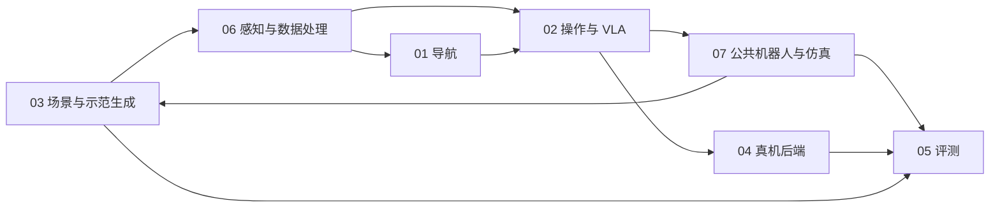

# 七组目录分工与交接

从 2026-11-24 起，按 **01～07 七个实际文件夹** 分组开发。负责人由团队认领；每组内部使用 `01.1`、`02.1` 等子任务编号。实现代码与运行脚本已迁入对应目录，不再使用此前十项 DEV 编号划分团队。

## 认领表

| 组 | 工作目录 | 职责 | 已有基础 | 负责人 |
|---|---|---|---|---|
| 01 | [01_navigation](../../01_navigation/README.md) | 跟踪优化、局部避障、停靠联调 | waypoint 控制、Mini SLAM、A*、巡检与 Web Console | 建图定位由原负责人维护，后续导航改进欢迎协作 |
| 02 | [02_manipulation_vla](../../02_manipulation_vla/README.md) | 抓取、IK、VLA 适配、任务状态机 | 物理抓取基线、Policy/Action 接口 | 待认领 |
| 03 | [03_data_generate](../../03_data_generate/README.md) | 场景生成、示范采集、随机化 | 官方场景生成、逐控制周期采集器 | 待认领 |
| 04 | [04_s2r](../../04_s2r/README.md) | Sim-to-Real、标定、真机执行后端 | 仿真参数导出、真机后端协议；没有真机实现 | 待认领 |
| 05 | [05_benchmark](../../05_benchmark/README.md) | 成功判据、批量评估、回归 | 接触检查、固定场景批量 runner、测试 | 待认领 |
| 06 | [06_data_process](../../06_data_process/README.md) | 感知、校验、清洗、数据格式转换 | RGB/观测结构、红色诊断、轨迹校验处理 | 待认领 |
| 07 | [07_extension](../../07_extension/README.md) | 公共接口、环境部署、可视化与扩展 | RobotInterface、安装、GUI、视频录制 | 待认领 |

## 各组对应脚本

```text
01_navigation/
├── navigation/navigation_interface.py   # waypoint 控制；后续导航算法放此包
└── run_navigation.py                    # 单独验证导航
02_manipulation_vla/
├── manipulation/arm_controller.py       # IK 与抓取控制
├── vla/policy_interface.py              # reset/predict 与执行循环
├── vla/observation_adapter.py            # 模型输入适配
├── vla/action_adapter.py                 # 动作语义、校验与执行
├── tasks/pick_red_cup.py                 # 任务编排
└── run_task.py                          # 完整任务入口
03_data_generate/
├── build_scene.py                      # 厨房生成与兼容适配
├── download_assets.py                  # 官方资产下载与校验
└── collect_episode.py                  # 连续控制周期示范数据采集
04_s2r/
├── s2r/backend.py                      # 待实现的真机后端协议
└── export_sim_contract.py              # 导出仿真坐标、限位、频率与单位
05_benchmark/
├── evaluation/success_checker.py       # 物理成功判据
├── tests/                             # 接口与数据回归测试
└── run_benchmark.py                    # 隔离输出的批量 runner
06_data_process/
├── perception/observation.py           # 观测数据结构
├── perception/red_cup.py               # 颜色诊断；待升级语义/三维定位
├── perception/camera.py                # 相机显示辅助
└── process_episode.py                  # 连续性校验、统计、剔除特权字段
07_extension/
├── robot/robot_interface.py            # 公共 MuJoCo/机器人适配
├── install.sh                         # 安装与版本锁定
├── run_sim.py                         # GUI / RGB 检查
└── record_demo.py                     # 实际仿真视频录制
```

每个目录另有 README，列出了当前能力、待做子任务、运行方式与验收建议。原有实现仅保留一份；旧顶层 `navigation/robot/vla/tasks/perception/evaluation/scripts/tests` 路径已迁移。

## 分工与交付任务

| 子任务 | 负责组 | 开发内容 | 交给谁 / 验收建议 |
|---|---|---|---|
| 01.1 | 导航 | 基于现有 A* 和 Mini SLAM 优化跟踪、检测动态障碍与重规划 | 02 调用；空闲/受阻/不可达路径均返回明确结果 |
| 01.2 | 导航 | 从物体位置选择可抓取的底盘停靠位姿 | 与 02 联调；终点误差目标 5 cm / 5° |
| 01.3 | 导航 | 超时停止、导航过程日志 | 05 读取；不可达时不无限执行 |
| 02.1 | 操作与 VLA | 抓取候选、碰撞检查、执行与失败恢复 | 05 验收；可达、不可达、阻挡场景均覆盖 |
| 02.2 | 操作与 VLA | VLA 客户端、checkpoint 专属观测/动作映射 | 先 mock，后真实 predict；明确单位、维度和时序 |
| 02.3 | 操作与 VLA | 任务状态机，统一调度导航和操作 | 01/06 提供能力；失败重试有次数上限 |
| 03.1 | 数据生成 | 场景/物体位置、颜色和实例随机化 | 05 使用固定试验清单；同 seed 可复现 |
| 03.2 | 数据生成 | RGB、状态、动作与结果的持续采集 | 06 校验；每个 episode 独立目录、时间对齐 |
| 03.3 | 数据生成 | 成功与失败示范、数据 manifest | 06/05 消费；记录策略、场景、seed 和版本 |
| 04.1 | S2R | 真机 SDK/通信后端与动作语义核对 | 02 调用；首先完成离线映射和停止行为检查 |
| 04.2 | S2R | 相机/关节/夹爪标定与延迟测量 | 06/02 使用；区分仿真参数和实测参数 |
| 04.3 | S2R | 仿真与真机差异评估、参数对齐 | 与 03/05 联调；记录硬件与软件版本 |
| 05.1 | 评测 | 导航、碰撞、抓取和任务成功指标 | 其他组统一使用，不随策略放宽判据 |
| 05.2 | 评测 | 多场景、多条件实验与结果汇总 | 03 提供场景；建议至少 20 个预先声明条件 |
| 05.3 | 评测 | 回归、失败分类和基线对比 | 所有组交付正常/失败样例及复现命令 |
| 06.1 | 数据处理 | RGB-D、标定、视觉目标三维定位 | 01/02 消费；目标缺失返回 invalid |
| 06.2 | 数据处理 | 清洗、对齐、去重、episode 级数据集划分 | 02 消费；避免同一 episode 跨训练/验证集 |
| 06.3 | 数据处理 | 模型所需数据格式转换、统计与版本化 | 与 02 明确格式；不将 actuator_ctrl 当作模型 Action |
| 07.1 | 公共与扩展 | RobotInterface、依赖、导入和配置维护 | 01/02/04/06 协商公共契约，05 做回归 |
| 07.2 | 公共与扩展 | GUI、视频、运行参数与展示 | 05 提供真实指标，02 提供阶段事件 |
| 07.3 | 公共与扩展 | 新传感器、新任务集成、安装交付 | 复用官方能力，保持第三方版本可追踪 |

## 接口与依赖



- **01 → 02**：当前 `navigate(robot, waypoints, timeout)`；后续可新增 `NavigationResult(success, final_pose, reason)`。后者尚未实现。
- **06 → 01/02**：当前 `Observation` 含 RGB、状态与时间戳；三维目标建议新增 `TargetEstimate(position_world, confidence, timestamp, valid)`，尚未实现。
- **02 → 07/04**：标准 `Action` 含底盘速度、绝对关节目标、归一化夹爪。04 的 `RealRobotBackend` 目前是协议，需要实现真实传输、校验与停止。
- **03 → 06**：`episode-1.0`，包括 `episode.json`、`trajectory.npz`、可选 `images/`。采样前后状态与时间成对存储；`actuator_ctrl` 是 MuJoCo 底层量，不等同于 VLA 动作。
- **06 → 02**：当前输出校验后的 `transitions.npz` 和 `report.json`；模型专属训练数据导出仍待开发。仿真完整 `qpos/qvel` 含物体真值，转换时剔除。
- **所有组 → 05**：提交可复制的命令、输入配置、正常/失败案例和结果。固定场景重复运行只衡量重复性，不作为跨场景泛化成功率。

公共单位保持米、弧度；世界坐标 Z 向上，四元数 wxyz；底盘速度在机器人坐标系。动作夹爪开度 0～1，原始状态夹爪范围为官方 `[-0.376, 0.56]`。默认物理 500 Hz、控制 20 Hz、相机 10 Hz。

## 共同文件和开发规则

| 公共位置 | 主要维护组 | 协作规则 |
|---|---|---|
| `07_extension/robot/robot_interface.py` | 07 | 01 提底盘需求，02 提机械臂需求，06 提观测需求；不各自复制一份接口 |
| `configs/robot.yaml` | 07，04 协作 | 频率/单位变化同步通知 02/03/06；真实标定另外保存 |
| `configs/scene.yaml`、`configs/assets.lock.json`、`scenes/` | 03 | 场景版本和随机化字段交给 05/06 |
| `configs/task.yaml` | 05，02 协作 | 所有策略共用验收阈值 |
| `project_bootstrap.py`、依赖锁 | 07 | 不在其他组添加隐式的全局路径或未锁依赖 |
| `third_party/` | 07 协调上游版本，03 管理资产 | 不为分工复制或大改官方源码 |
| `out/` | 各组自己的子目录 | 不覆盖已有 episode、视频或批量结果 |

编号文件夹不是 Python 包名。现有入口已调用根目录 `project_bootstrap.activate()`；新脚本参考任一现有入口，加载后使用 `from navigation...`、`from manipulation...`、`from vla...` 等正常导入。

推荐分支名 `01-navigation-obstacle`、`02-vla-client`，任务标题 `[03.2] 增加动作与图像同步采集`。每组只修改自己的实现；公共签名或 schema 的变化由上下游一起确认，再更新文档和测试。

## 从已有基线开始联调

在项目根目录运行；安装见 [主 README](../../README.md)。

```bash
# 各组先确认统一基线
.venv/bin/python -m pytest -q
.venv/bin/python 01_navigation/run_navigation.py --headless
.venv/bin/python 02_manipulation_vla/run_task.py --headless --no-cameras

# 03 采集 → 06 校验处理
.venv/bin/python 03_data_generate/collect_episode.py --output out/team03/episode_001
.venv/bin/python 06_data_process/process_episode.py \
  --input out/team03/episode_001 --output out/team06/episode_001

# 04 离线核对接口，05 独立评估
.venv/bin/python 04_s2r/export_sim_contract.py --output out/team04/sim_contract.json
.venv/bin/python 05_benchmark/run_benchmark.py --episodes 1 --output out/team05/baseline_001
```

先让 01/02/03/05/06/07 基于现有仿真并行开发；04 从离线契约和标定准备开始。02 的 VLA 先 mock 联调，再选择真实 checkpoint；不默认要求训练模型或已经具备真机。

## 旧编号与旧路径对照

此前交付的视频仍使用旧 DEV 编号，只代表当时的细分任务。后续分工以本文件七组目录为准，录制器源码已改用 TEAM-01～07。

| 旧编号 | 新组 / 目录 |
|---|---|
| DEV-01 观测 | 06_data_process，底层采样由 07_extension 协作 |
| DEV-02 视觉 | 06_data_process |
| DEV-03 导航 | 01_navigation |
| DEV-04 抓取 | 02_manipulation_vla |
| DEV-05 编排 | 02_manipulation_vla |
| DEV-06 推理 | 02_manipulation_vla |
| DEV-07 模型适配 | 02_manipulation_vla |
| DEV-08 评测 | 05_benchmark |
| DEV-09 场景 | 03_data_generate |
| DEV-10 展示 | 07_extension |

原 `robot/arm_controller.py` 移到 `02_manipulation_vla/manipulation/arm_controller.py`，导入改为 `from manipulation.arm_controller import solve_ik`。原 `robot/robot_interface.py` 移到 `07_extension/robot/robot_interface.py`；bootstrap 后仍使用原 `robot.robot_interface` 包名。其他包也保留内部包名。测试命令改为 `.venv/bin/python -m pytest -q`，由 `pytest.ini` 定位到 `05_benchmark/tests/`。

## 交接模板

```text
组 / 子任务：02 / 02.2
负责人：
本次范围：
修改的本组文件：
公共接口变更（如有）：
上下游输入输出样例：
复现命令：
正常和失败案例结果：
产物路径与版本：
尚未完成的部分：
```
