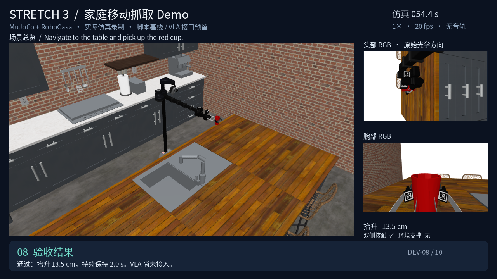

# 实际仿真示意视频

**[播放 / 下载 stretch_vla_demo.mp4](stretch_vla_demo.mp4)** · [封面](demo_poster.png) · [元数据与 SHA-256](stretch_vla_demo.json) · [二次开发分工](../docs/development/README.md)



## 内容与结果

本视频录制实际 MuJoCo 连续运行，控制来源为 `scripted_oracle_baseline`。目标位置来自仿真真值，VLA 尚未加载。它用于展示现有工程、物理抓取和后续接口开发位置，不代表预训练模型已完成该任务。

| 项目 | 本次录制 |
|---|---|
| 画面 | 1280×720，20 fps，1126 帧 |
| 时长 / 速度 | 56.3 秒，1 倍仿真时间，无跳帧剪辑或变速 |
| 编码 | H.264、yuv420p、Rec.709、MP4 faststart |
| 音频 | 无音轨 |
| 视角 | 外部场景总览、头部 RGB、腕部 RGB |
| 相机刷新 | 10 Hz；20 fps 视频中的相邻两帧可能使用同一份 RGB |
| 物理 / 控制 | 500 Hz / 20 Hz |
| 抓取结果 | 成功，抬升 0.134812 m，双侧接触、无环境支撑，保持 2 秒 |
| 结果展示 | 任务在仿真 54.3 秒完成，之后继续运行物理 2 秒显示结果 |

头部图像保留原始光学方向；右侧 RGB 没有裁切或拉伸。这份既有视频中的 DEV-01～10 是旧版细分任务编号。项目现按 01～07 七组目录开发，旧编号到新目录的对应关系见分工手册；录制器已改用 TEAM 编号，新录制会显示七组归属。具体结果保存在 [视频 JSON](stretch_vla_demo.json)，该文件同时记录场景及视频的 SHA-256。

| 视频时间 | 阶段 | 画面中的旧任务编号 |
|---|---|---|
| 00:00–00:03 | 初始化与观测 | DEV-01、DEV-05 |
| 00:03–00:38.5 | 导航到岛台 | DEV-03 |
| 00:38.5–00:44 | 调整预抓取位姿 | DEV-04 |
| 00:44–00:47.8 | 接近红杯 | DEV-04 |
| 00:47.8–00:49.3 | 闭合夹爪 | DEV-04、DEV-08 |
| 00:49.3–00:52.3 | 抬升 | DEV-04 |
| 00:52.3–00:54.3 | 检查与保持 | DEV-08 |
| 00:54.3–00:56.3 | 显示验收结果，物理继续运行 | DEV-08、DEV-10 |

## 重新录制

先按 [主 README](../README.md) 安装并生成场景，再在项目根目录执行：

```bash
# 可选录制依赖，固定版本；不改变核心仿真依赖锁
UV_CACHE_DIR=.cache/uv .tools/uv pip install --python .venv/bin/python -r requirements-video.txt

# 完整流程；请为每次实验选择新的输出目录
MUJOCO_GL=egl .venv/bin/python 07_extension/record_demo.py \
  --output out/my_demo/demo.mp4 --run-dir out/my_demo/run
```

`imageio-ffmpeg==0.6.0` 提供本次使用的 FFmpeg 可执行文件，不要求系统另外安装 FFmpeg。录制需要可用的 EGL。中文字体默认读取 `/usr/share/fonts/opentype/noto/NotoSansCJK-Regular.ttc`，其他安装位置可通过 `--font /path/to/NotoSansCJK-Regular.ttc` 指定；字体不存在时会明确报错。

只检查渲染和编码时，可先录两秒预览；预览不执行完整任务，也不声称抓取成功：

```bash
MUJOCO_GL=egl .venv/bin/python 07_extension/record_demo.py \
  --preview-seconds 2 \
  --output out/my_preview/preview.mp4 --run-dir out/my_preview/run
```

完整录制输出：

- `--output` 指定的 MP4，以及同名 `.json` 元数据。
- MP4 所在目录的 `demo_poster.png` 结果封面。预览模式不生成结果封面。
- `--run-dir` 下的 `metrics.json`、`stages.json`、`success_trace.json`、阶段图片/状态快照、`frame_times.json` 和 `encode.log`。

已有 MP4 不会被覆盖。封面和实验日志使用固定文件名，因此每次录制应同时使用新的视频目录与 `--run-dir`。本次交付的运行记录位于 `out/video_run/`。

录制器源码为 [07_extension/record_demo.py](../07_extension/record_demo.py)，通过任务的 `on_phase` 回调标记阶段，并在每个控制周期结束时取帧；不修改控制指令。源观测为 10 Hz，视频场景总览为 20 Hz；编码用时可以长于仿真时长，不影响视频的 1 倍播放速度。

## 检查与扩展

已对本次 MP4 进行完整解码，核对 1126 帧、分辨率、帧率和 SHA-256，并检查逐帧仿真时间增量为 0.05 秒、RGB 采样延迟不超过 0.1 秒。另抽取各阶段画面检查布局与内容。检查报告和抽帧保存在 `out/video_qa/`。

视频中的成功来自接触与保持检查；不能据此推断其他布局或目标也能成功。新增失败案例、视角、批量视频与实验可视化属于 [第 07 组](../07_extension/README.md)，成功判据与统计属于 [第 05 组](../05_benchmark/README.md)。

机器人和厨房资产分别来自 Hello Robot Stretch MuJoCo、RoboCasa。资产来源、固定版本和许可归属见 [主 README](../README.md#上游与资产归属) 和 [兼容性记录](../docs/compatibility.md)。
